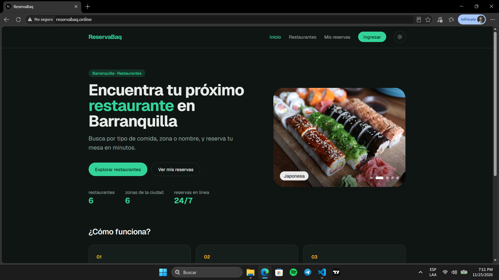
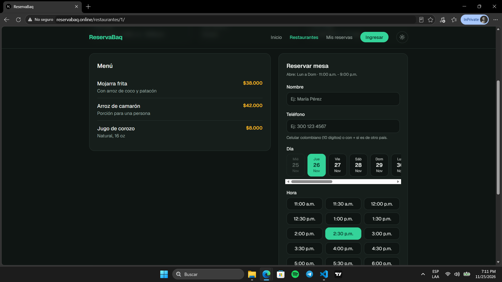
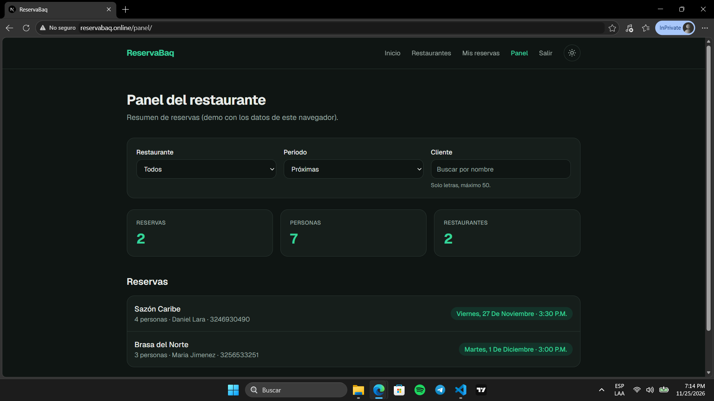
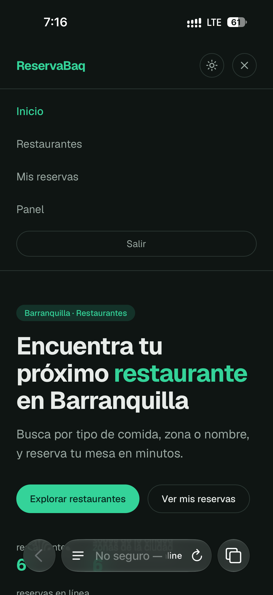
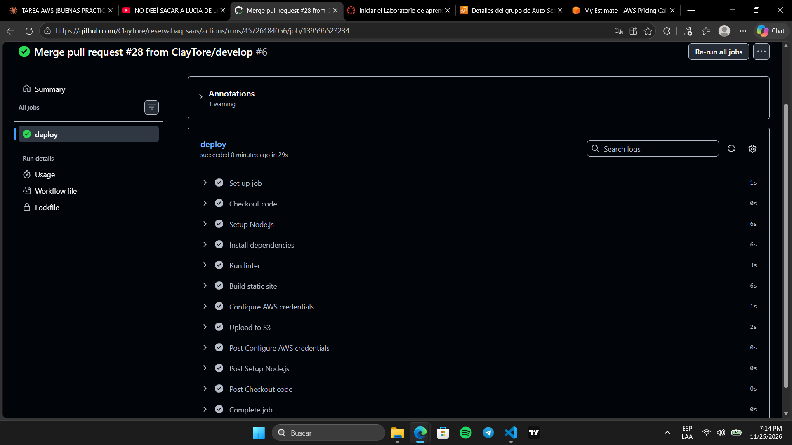
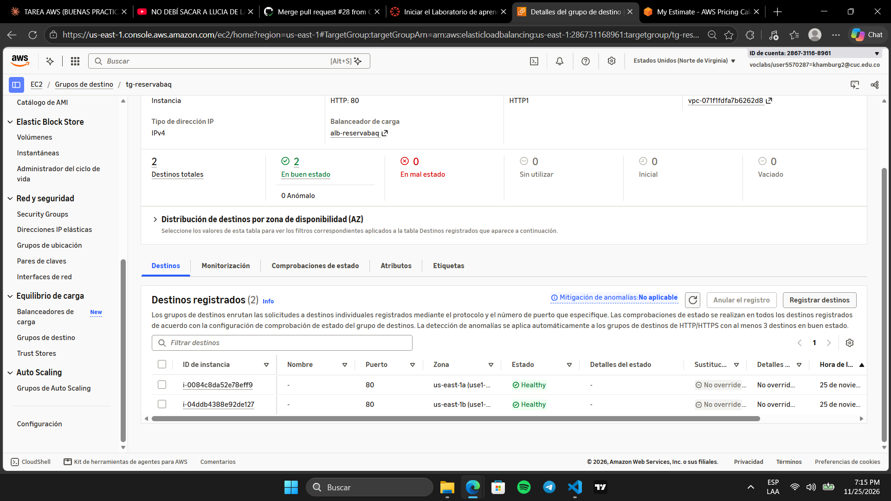

# ReservaBaq

SaaS to discover and book restaurants in Barranquilla, Colombia.

Diners can search restaurants by name, area or type of food, check the menu, schedule and dress code, and book a table. Restaurant owners get a private panel with a summary of their reservations.

**Live site:** http://reservabaq.online

## Features

- Landing page with a food photo carousel
- Restaurant catalog with search by name or area and filter by type of food
- Restaurant detail page with schedule, dress code, address and menu with prices
- Table reservation: pick a day (next 14 days) and a time slot based on each restaurant's hours
- Field validation: name only letters, phone only digits (or + for other countries)
- "Mis reservas" page with upcoming and past bookings, and a confirmation before cancelling
- Demo login (blocked after 5 wrong attempts) and a protected panel with filters and stats
- Light/dark theme, mobile menu and a custom 404 page

## Tech stack

- [Next.js 16](https://nextjs.org/) (App Router, static export) with React and TypeScript
- Tailwind CSS v4
- ESLint
- GitHub Actions for CI/CD
- AWS: S3, EC2 with Auto Scaling, Application Load Balancer

## Getting started

Requirements: Node.js 20 or newer and npm.

```bash
git clone https://github.com/ClayTore/reservabaq-saas.git
cd reservabaq-saas
npm install
npm run juju
```

Then open http://localhost:3000.

### Demo login

| Email | Password |
|---|---|
| demo@reservabaq.com | reservabaq2026 |

> This login is only a demo that runs in the browser. It is not real security. In production we would use a service like Amazon Cognito.

## Scripts

| Command | What it does |
|---|---|
| `npm run juju` | Starts the development server |
| `npm run lint` | Checks the code with ESLint |
| `npm run build` | Builds the static site into the `out/` folder |

## Build and deploy

Build the static site locally:

```bash
npm run lint
npm run build
```

The site is generated in the `out/` folder.

To deploy, open a pull request from `develop` to `main`. When it is merged, GitHub Actions builds the site and uploads `out/` to S3. The EC2 instances pick up the new version within a minute.

Before deploying from AWS Academy, update the `AWS_ACCESS_KEY_ID`, `AWS_SECRET_ACCESS_KEY` and `AWS_SESSION_TOKEN` secrets, because the lab credentials change every session.

## Project structure

```
app/             Pages (landing, restaurantes, restaurantes/[id], mis-reservas, login, panel)
components/      Reusable UI components (Navbar, RestaurantCard, FormularioReserva, ...)
data/            Sample restaurant data
lib/             Types, validation, schedules, demo auth, reservation helpers and hooks
public/          Static files (carousel photos, health.html for the load balancer)
docs/            Architecture diagram and screenshots
.github/         GitHub Actions workflow
```

## Git workflow

We use Gitflow:

- `main` is production. Every push to `main` deploys the site.
- `develop` is where we integrate our work.
- New work goes in `feature/*`, `fix/*` or `docs/*` branches and is merged into `develop` with a pull request.
- Every pull request needs one approval from the other team member.
- `main` and `develop` are protected (no direct pushes, no force pushes, no deletion).
- Commit messages follow [Conventional Commits](https://www.conventionalcommits.org/) (`feat:`, `fix:`, `docs:`, `ci:`, `refactor:`, `chore:`).

## CI/CD

The workflow in `.github/workflows/deploy.yml` runs on every push to `main`:

1. Install dependencies with `npm ci`
2. Run the linter
3. Build the static site
4. Upload the `out/` folder to an S3 bucket with `aws s3 sync --delete`

The EC2 instances behind the load balancer sync the files from S3 every minute, so the new version goes live without touching the servers. AWS credentials are stored as GitHub secrets, never in the code.

## Architecture

See [docs/architecture.md](docs/architecture.md) for the AWS diagram and a description of each component.

## Screenshots

| Landing | Reservation |
|---|---|
|  |  |

| Panel | Mobile |
|---|---|
|  |  |

| Deploy in GitHub Actions | Load balancer targets |
|---|---|
|  |  |

## Resources

- [Next.js static exports](https://nextjs.org/docs/app/guides/static-exports)
- [GitHub Actions documentation](https://docs.github.com/en/actions)
- [Amazon EC2 Auto Scaling](https://docs.aws.amazon.com/autoscaling/ec2/userguide/what-is-amazon-ec2-auto-scaling.html)
- [Application Load Balancer](https://docs.aws.amazon.com/elasticloadbalancing/latest/application/introduction.html)
- [Conventional Commits](https://www.conventionalcommits.org/)
- [Tailwind CSS](https://tailwindcss.com/docs)

## Team

| Name | GitHub |
|---|---|
| Kennyc Hamburger | [@ClayTore](https://github.com/ClayTore) |
| Susan Acuña | [@sacuna12](https://github.com/sacuna12) |

Final project for *Buenas Prácticas en el Desarrollo de Software*, Universidad de la Costa (CUC).