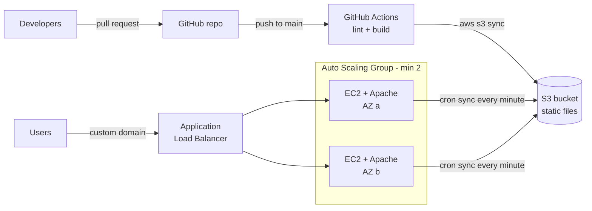

# Architecture

ReservaBaq is a static Next.js site. GitHub Actions builds it and uploads it to S3. EC2 instances behind an Application Load Balancer serve it with Apache and pull new versions from S3 every minute.

## Components

| Component | What it does |
|---|---|
| GitHub Actions | On every push to `main` runs lint and build, then uploads `out/` to S3 |
| S3 bucket | Stores the latest version of the static site |
| Custom AMI (`web-base-v1`) | Amazon Linux with Apache and cron already installed |
| Launch template (`lt-web`) | Uses the AMI and a user data script that syncs the site from S3 and creates a cron job |
| Auto Scaling Group | Keeps at least 2 instances running in different availability zones |
| Target group | Checks `/health.html` to know which instances are healthy |
| Application Load Balancer | Receives the traffic from the domain and spreads it between the instances |

## Security

- `sg-alb` allows HTTP (80) from the internet to the load balancer.
- `sg-web` only allows HTTP (80) from `sg-alb`, so the instances can't be reached directly.
- AWS credentials are stored as GitHub secrets, never in the repo.
- The instances use the `LabInstanceProfile` role to read from S3, so no keys are saved on the servers.

## Why static export

The site has no backend, so `output: "export"` turns every page into plain HTML, CSS and JS. This means any web server can serve it, and updating the site is just copying files to S3.